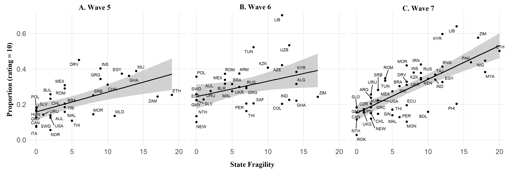
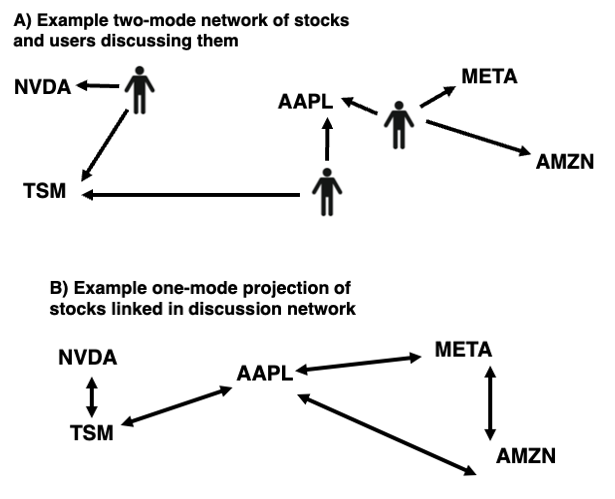
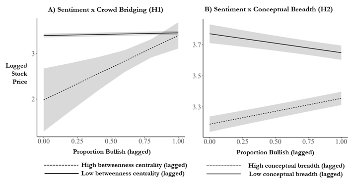
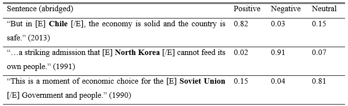
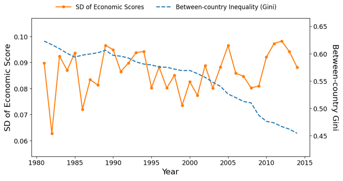

## Is Science a World Culture? Restricted Actorhood and Trust in Science

*with Ibrahim Enes Atac*

World polity theorists argue that science attained worldwide authority through the expansion of liberal actorhood in the postwar era. However, we argue that power hierarchies operating between countries, within countries, and at the individual level generate divergent heuristic pathways through which individuals legitimize science. Under restricted conditions of actorhood, science is valued as a pragmatic source of power in the face of threats. By contrast, when such threats are attenuated, science is valued as a form of cultural capital. Using World Values Survey data from 70 countries, we show that trust in science is associated with both restricted and liberal conditions of actorhood. Individuals in fragile states express higher trust in science, whereas in more secure states, the highly educated, the affluent, and urban residents exhibit higher trust. We further find that restricted and liberal conditions of actorhood can combine: marginalized ethnic groups in secure states also exhibit higher trust.

 

**Figure 1. State Fragility and Trust in Science**

::: {.text-center}
{width=100%}
:::

 

**Figure 2. Marginal Effect of Urban Elite Status by State Fragility**

::: {.text-center}
{width=72%}
:::

## Cunning of the Bulls? Discussion Networks and Crowd Wisdom in Stock Market Predictions

*with Daniel DellaPosta*

**ABSTRACT**

In uncertain decision-making environments, we often rely on peers to provide guiding signals. While such social influence can produce “wiser” crowds, the tendency to self-sort into homogeneous enclaves can also trap members of the crowd in information-poor echo chambers. This paper examines the intelligence of networked predictions using data from Stocktwits.com, a Twitter-like social network where users follow stocks, post comments, and share predictions. Applying network measures, computational text analysis, and panel data models to approximately 160 million posts spanning nearly a decade, we show that predictions about future price movement were more accurate for stocks discussed by “bridging” crowds of users from different parts of the discussion network, and when the discussions themselves were more diverse in content. While these two mechanisms—network bridging and discursive diversity—are often conceptually linked in previous work, we surprisingly find that their effects were largely independent. This study provides large-scale observational evidence for the wisdom of (network) crowds but also highlights the critical ways this wisdom depends on how those crowds are embedded in network and cultural spaces.

 

**Figure 1. Toy example of stock discussion network**

::: {.text-center}
{width=100% fig-alt="A two-mode network linking users to stocks they discuss and its one-mode projection linking stocks discussed by the same users."}
:::

 

**Figure 2. Visual depiction of interaction effects**

::: {.text-center}
{width=100% fig-alt="Two plots show how the relationship between bullish sentiment and logged stock price varies with crowd bridging and conceptual breadth."}
:::

## Material Convergence, Symbolic Divergence: Economic Representation of Nation-States in U.S. Media, 1981 to 2014

**Abstract**

Recent studies show between-country income inequality has declined since the early 2000s, but less is known about how global economic hierarchies are symbolically constructed. This paper examines U.S. media representations of foreign nation-states from 1981 to 2014 and asks whether symbolic hierarchies converged with material inequalities or diverged. Using 1.3 million New York Times articles, I estimate sentence-level economic valence toward countries with a fine-tuned DeBERTa-v3 model. Despite declining global income inequality, the dispersion of economic valences across countries increased after two major crises: the collapse of the Soviet Union and the Great Recession. Fixed-effects models show that GDP per capita and democratic development were positively associated with economic portrayals during the Cold War and after the collapse of the Soviet Union, but these associations disappeared following the Great Recession. The findings reveal symbolic global hierarchies can diverge sharply from material trends during periods of major geopolitical and economic disruption.

 

**Table 1. Example Predictions from the Fine-Tuned Classifier**

::: {.text-center}
{width=100% fig-alt="Classifier probabilities for positive, negative, and neutral sentiment, respectively: Chile (2013), 0.82, 0.03, 0.15; North Korea (1991), 0.02, 0.91, 0.07; Soviet Union (1990), 0.15, 0.04, 0.81."}
:::

 

**Figure 1. Trends in Global Economic Inequality and Media Economic Representation**

::: {.text-center}
{width=100% fig-alt="From 1981 to 2014, between-country income inequality generally declines while the dispersion of media economic scores fluctuates and rises after the Great Recession."}
:::
