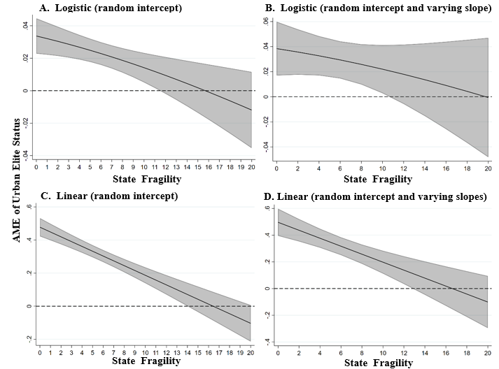

## Is Science a World Culture? Restricted Actorhood and Trust in Science

*with Ibrahim Enes Atac*

World polity theorists argue that science attained worldwide authority through the expansion of liberal actorhood in the postwar era. However, we argue that power hierarchies operating between countries, within countries, and at the individual level generate divergent heuristic pathways through which individuals legitimize science. Under restricted conditions of actorhood, science is valued as a pragmatic source of power in the face of threats. By contrast, when such threats are attenuated, science is valued as a form of cultural capital. Using World Values Survey data from 70 countries, we show that trust in science is associated with both restricted and liberal conditions of actorhood. Individuals in fragile states express higher trust in science, whereas in more secure states, the highly educated, the affluent, and urban residents exhibit higher trust. We further find that restricted and liberal conditions of actorhood can combine: marginalized ethnic groups in secure states also exhibit higher trust.

 

**Figure 1. State Fragility and Trust in Science**

::: {.text-center}
{width=100%}
:::

 

**Figure 2. Marginal Effect of Urban Elite Status by State Fragility**

::: {.text-center}
{width=72%}
:::

